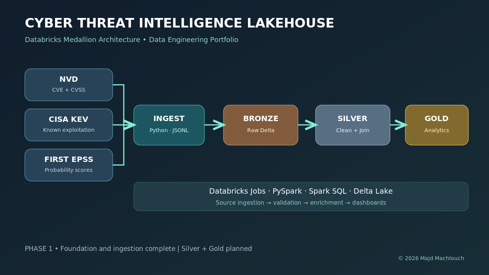

<div align="center">

# 🛡️ Cyber Threat Intelligence Lakehouse
### From raw vulnerability feeds to security analytics — built with a Databricks Medallion Architecture


**Python · NVD · CISA KEV · FIRST EPSS · PySpark · Delta Lake · Spark SQL**

</div>



> **Project status:** Phase 1 foundation implemented. Raw API ingestion, offline fixtures, unit tests, CI, and a starter Databricks Bronze notebook are included. Silver, Gold, and production incremental Delta pipelines are planned, not yet implemented.

## 🎯 Business problem

Security analysts need a unified view of **what is vulnerable**, **what is known to be exploited**, and **what is likely to be exploited**. Those signals live in separate sources. This project lays the foundation for a reproducible analytics lakehouse that connects the signals by CVE identifier.

## 🧱 Medallion architecture

| Layer | Purpose | Status |
|---|---|---|
| Landing | Collect original NVD, KEV, EPSS source records in JSONL | ✅ Implemented |
| Bronze | Persist source payloads to Delta tables | 🟡 Starter notebook |
| Silver | Normalize, validate, deduplicate and enrich | 🔜 Planned |
| Gold | Analytics marts and prioritization dashboards | 🔜 Planned |

## 🚀 Run locally in under a minute

```bash
# Python 3.10+ only — no pip install required for Phase 1
python3 -m src.ingestion.run --mode sample
python3 -m unittest discover -s tests -v
```

The command creates `data/raw/nvd.jsonl`, `kev.jsonl`, and `epss.jsonl`, using deliberately small example records so you can run the pipeline offline.

To ingest **real** public data:

```bash
python3 -m src.ingestion.run --mode live --start 2026-09-01 --end 2026-09-03 --limit 100
```

Optional NVD credentials: copy `.env.example` for reference and export `NVD_API_KEY` in your shell. The standard-library script does not automatically load `.env`.

## 🗂️ Project layout

```text
src/ingestion/     API clients, retries, pagination, JSONL landing pipeline
data/samples/      Small *illustrative* source-shaped fixture datasets
notebooks/         Databricks Bronze starter; Silver/Gold placeholders
assets/            Original project architecture diagrams
docs/              Setup, sources, data model and engineering decisions
tests/             Standard-library unit tests
.github/workflows/ Continuous integration
```

## 📊 Planned analytics

- Critical CVEs with a confirmed exploitation signal
- Vendors and affected products with the most exposed vulnerabilities
- EPSS distribution and day-over-day changes
- Prioritization based on explicitly labeled, documented model assumptions

## 🔗 Data resources

| Provider | Public resource |
|---|---|
| NIST NVD | https://nvd.nist.gov/developers/vulnerabilities |
| CISA KEV | https://github.com/cisagov/kev-data |
| FIRST EPSS | https://api.first.org/epss/ |

Learn more in [Data Sources](docs/data_sources.md), [Architecture](docs/architecture.md), and [Setup](docs/setup.md).

## 🧭 Roadmap

- [x] Repository and API ingestion clients
- [x] Local source-shaped fixture data and tests
- [x] CI and architecture visualization
- [x] Starter Databricks Bronze notebook
- [ ] Robust Bronze Delta MERGE with ingestion checkpoints
- [ ] Silver schema normalization, data quality and enrichment
- [ ] Gold analytics and Databricks SQL dashboard
- [ ] Job orchestration, monitoring and performance benchmarking

---

<div align="center"><sub>Designed and maintained by <b>Majd Machlouch</b> · © 2026</sub></div>
