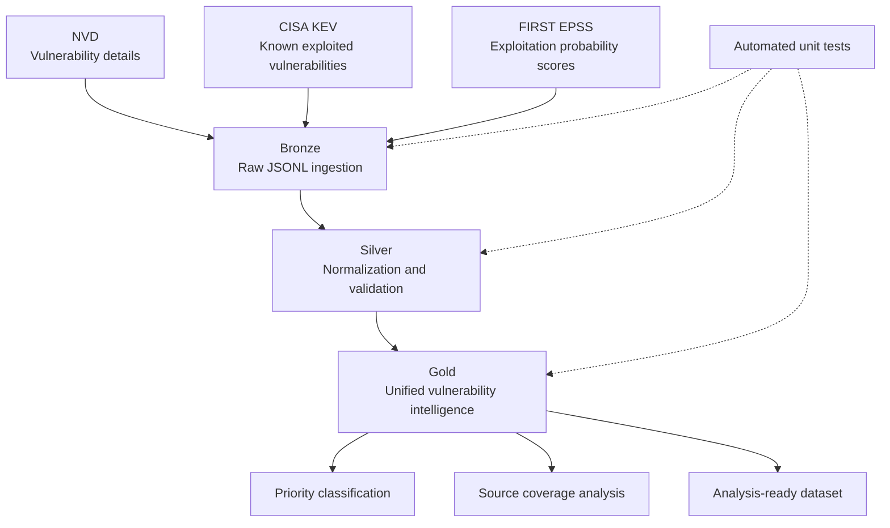

# Cyber Threat Intelligence Lakehouse

**A data engineering project for unified vulnerability intelligence.**


## Overview

Cyber Threat Intelligence Lakehouse collects vulnerability information from public cybersecurity sources, validates and standardizes records, enriches data across sources, and produces a unified dataset for analysis.

The current pipeline uses **Python and JSON Lines (JSONL)** and follows the **Medallion Architecture**: Bronze, Silver, and Gold. **Apache Spark, Delta Lake, and Databricks are planned extensions** and are not yet part of the current implementation.

## Objectives

- Ingest data from multiple public vulnerability intelligence sources.
- Validate, normalize, and deduplicate records.
- Correlate source records using CVE identifiers.
- Preserve source coverage and missing-source information.
- Produce a unified Gold dataset with an explainable priority classification.
- Test ingestion and transformation logic automatically.

## Architecture



## Data sources

| Source | Purpose | Key information |
|---|---|---|
| [NVD](https://nvd.nist.gov/) | National Vulnerability Database | CVE IDs, descriptions, CVSS scores, severity, publication metadata |
| [CISA KEV](https://www.cisa.gov/known-exploited-vulnerabilities-catalog) | Known Exploited Vulnerabilities Catalog | Known exploitation, vendor/product details, remediation dates |
| [FIRST EPSS](https://www.first.org/epss/) | Exploit Prediction Scoring System | EPSS scores, percentiles, score dates |

CVE ID is the primary key used to correlate records. NVD provides vulnerability details, KEV identifies vulnerabilities known to be exploited in the wild, and EPSS estimates the probability of exploitation.

## Pipeline layers

### Bronze — raw ingestion

Retrieves source data and stores source records as JSON Lines files.

Implemented capabilities include:
- NVD API pagination and date-window validation.
- CISA KEV catalog ingestion.
- EPSS retrieval for CVE identifiers.
- NVD enrichment for known-exploited CVEs.
- Deduplication of requested CVE identifiers.

### Silver — data quality and standardization

Cleans and standardizes source records before integration.

Implemented capabilities include:
- CVE identifier normalization.
- Field extraction and standardization.
- Duplicate handling.
- EPSS score and percentile validation.
- Separate Silver outputs for NVD, KEV, and EPSS.

### Gold — unified vulnerability intelligence

Combines the source records into one analysis-ready record per CVE.

The Gold dataset includes:
- CVE identifier and available vulnerability details.
- CVSS score and severity when available.
- EPSS score and percentile when available.
- Known-exploited status.
- Source coverage flags: `has_nvd_data`, `has_kev_data`, and `has_epss_data`.
- A project-specific priority classification.

## Priority classification

The project uses a custom, explainable priority model. It is **not an official CVSS severity classification**.

| Priority | Current rule |
|---|---|
| `CRITICAL` | CVSS score is at least 9.0 |
| `HIGH` | Known exploited, or EPSS score is at least 0.5 |
| `MEDIUM` | CVSS score is at least 7.0, or EPSS score is at least 0.1 |
| `LOW` | None of the above rules apply |

Rules are evaluated in order. The original severity field is retained separately from the custom priority.

## Repository structure

```text
cyber-threat-intelligence-lakehouse/
├── src/
│   ├── ingestion/
│   │   ├── clients.py
│   │   └── run.py
│   └── transformation/
│       ├── silver.py
│       ├── run.py
│       ├── gold.py
│       └── gold_run.py
├── scripts/
│   ├── analyze_gold.py
│   └── analyze_source_overlap.py
├── tests/
├── data/
│   ├── raw/       # Generated locally; not committed
│   ├── silver/    # Generated locally; not committed
│   └── gold/      # Generated locally; not committed
├── .gitignore
├── requirements.txt
└── README.md
```

The exact file list may evolve as the project develops.

## Getting started

### Requirements

- Python 3.10 or newer (developed and tested with Python 3.12).
- Git.
- Internet access for live source ingestion.

### 1. Clone the repository

```bash
git clone https://github.com/Majd2404/cyber-threat-intelligence-lakehouse.git
cd cyber-threat-intelligence-lakehouse
```

### 2. Create and activate a virtual environment

Linux/macOS:

```bash
python3 -m venv .venv
source .venv/bin/activate
```

Windows PowerShell:

```powershell
py -m venv .venv
.venv\Scripts\Activate.ps1
```

### 3. Install dependencies

```bash
python -m pip install --upgrade pip
pip install -r requirements.txt
```

### 4. Run sample ingestion

```bash
python -m src.ingestion.run --mode sample
```

### 5. Run Silver transformations

```bash
python -m src.transformation.run
```

### 6. Build the Gold dataset

```bash
python -m src.transformation.gold_run
```

### 7. Analyze the results

```bash
python scripts/analyze_gold.py
python scripts/analyze_source_overlap.py
```

### 8. Run tests

```bash
python -m unittest discover -s tests -v
```

### 9. Run live ingestion

Check the command-line options in `src/ingestion/run.py` before running against live APIs. For example, if the current CLI supports the options shown below:

```bash
python -m src.ingestion.run --mode live --start 2026-09-01 --end 2026-09-03 --limit 100
```

Use an appropriate date window and follow the API providers' rate limits. An NVD API key may be configured through the environment variable `NVD_API_KEY` if supported by the current implementation. Never commit API keys or tokens.

## Tests and validation

The project previously passed **18 unit tests** covering ingestion, Silver transformations, and Gold logic. Re-run the test command above after pulling the latest changes to confirm the current status.

## Example output

The Gold dataset is written to:

```text
data/gold/vulnerability_intelligence.jsonl
```

Each line is a JSON object representing a CVE. The actual fields depend on which source data is available for that CVE.

Generated data under `data/raw/`, `data/silver/`, and `data/gold/` is intended for local experimentation and should generally not be committed. Keep small, intentionally curated sample fixtures in the repository if you want reproducible examples.

## Technology stack

**Implemented**
- Python
- REST API ingestion
- JSON Lines
- Data validation and deduplication
- Unit testing with `unittest`

**Planned**
- Apache Spark and PySpark
- Delta Lake
- Databricks notebooks
- Lakeflow Jobs / pipeline orchestration
- Additional data quality checks and incremental processing

## Roadmap

- [x] Multi-source vulnerability ingestion
- [x] Silver-layer normalization and validation
- [x] Gold-layer vulnerability intelligence dataset
- [x] Unit tests for core pipeline logic
- [ ] Port transformations to PySpark
- [ ] Store Bronze, Silver, and Gold as Delta tables in Databricks
- [ ] Add scheduled orchestration with Lakeflow Jobs
- [ ] Add incremental processing and more data quality checks
- [ ] Publish reproducible notebook examples

## Data use and attribution

This project consumes publicly available vulnerability information. Refer to the original sources for authoritative data, terms, and updates:

- [NVD](https://nvd.nist.gov/)
- [CISA KEV Catalog](https://www.cisa.gov/known-exploited-vulnerabilities-catalog)
- [FIRST EPSS](https://www.first.org/epss/)

This is an independent learning and portfolio project and is not affiliated with or endorsed by these organizations.

## Author

**Majd Machlouch**

- GitHub: [@Majd2404](https://github.com/Majd2404)

---

*Built for learning and demonstrating practical data engineering workflows in cybersecurity.*